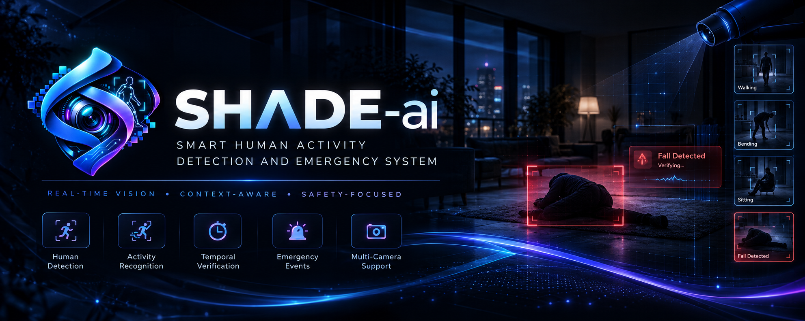

<div align="center">
  

# SHADE-ai

### Smart Human Activity Detection & Emergency System

**Where style meets precision. Where context guides response.**

  <p>
    <a href="#-the-idea">The idea</a> ·
    <a href="#-current-state">Current state</a> ·
    <a href="#-quick-start">Quick start</a> ·
    <a href="#-architecture">Architecture</a> ·
    <a href="#-roadmap">Roadmap</a>
  </p>

  <p>
    
    
    
    
  </p>
</div>

<p align="center">
  
</p>

> **SHADE-ai is a safety-monitoring aid, not a medical diagnosis system, a guaranteed security product, or a replacement for human emergency response.**

---

## ◈ The idea

SHADE-ai is a local-first Django and React platform for human-activity monitoring, temporal event verification, and careful operator review.

Its core philosophy is deliberately simple:

```text
OBSERVE → ANALYZE → VERIFY → RESPOND
```

The system is designed around a safer alternative to one-frame alarm logic:

```text
ONE UNCERTAIN PREDICTION → IMMEDIATE ALARM   ✕

MULTIPLE OBSERVATIONS + TEMPORAL CONTEXT
+ EXPLICIT THRESHOLDS + HUMAN REVIEW       ✓
```

The first target scenario is fall-event verification. The repository already contains the contracts and boundaries needed to connect frame input, detection, tracking, posture signals, temporal reasoning, persistence, and dashboard review without pretending that unfinished adapters are production-ready.

## ✦ Current state

The project currently delivers **Phase 5A–5D vision/event foundations and Phase 6A local worker supervision**. A separate Django subprocess supervisor now controls the existing worker and reports provider/source readiness; an API runtime check with the real RTMO-S provider verified start, graceful stop, and invalid-video failure. A separate deterministic injected-observation run verified the worker/verifier/event-service/MongoDB path. RTMO has not produced a verified event on representative fall data; no authorized fall evaluation, model-backed MongoDB event, or accuracy claim is established. This is not a validated fall-detection or production monitoring system.

| Area                             |      State      | What is real today                                                                                                      |
| -------------------------------- | :-------------: | ----------------------------------------------------------------------------------------------------------------------- |
| Django project                   | **Implemented** | Split settings, routing, health diagnostics, capabilities, and local configuration under `app/`.                        |
| Camera API                       | **Implemented** | Validated camera-source contracts for `webcam`, `rtsp`, `video_file`, and `synthetic`.                                  |
| Event API                        | **Implemented** | Validated emergency-event metadata and optional nested provenance, with legacy events represented as `provenance: null`. |
| MongoDB boundary                 | **Implemented** | MongoEngine documents persist camera and event metadata when MongoDB is reachable.                                      |
| Vision contracts                 | **Implemented** | Vendor-neutral frame, detection, tracking, pose, activity, source, pipeline, and decision types.                        |
| Temporal rule                    | **Implemented** | Conservative bounded fall verification with transition, persistence, duration, and confidence gates.                    |
| React dashboard                  | **Implemented** | Responsive JSX interface with overview, event-review, source views, status messaging, and accessible controls.          |
| Branding                         | **Implemented** | Official `public/Logo.png` and `public/Banner.png` are used by the product and documentation.                           |
| Monitoring control plane         | **Implemented** | Django supervises one separate worker process and reports observed readiness/state; local in-memory single-worker scope only. |
| WebSocket delivery               |  **Boundary**   | Read-oriented route exists; live worker event publication is not connected.                                             |
| Video-file worker                | **Implemented** | Standalone `run_monitor` processes configured local video sequentially; provider initialization fails closed.           |
| RTMO-S pose provider             | **Experimental**| Optional MMPose RTMO-S body7 ONNX adapter emits normalized person/keypoint observations on CPU.                           |
| Event provenance                 | **Implemented** | Worker supplies provider/model/source/camera/time metadata; model version and artifact digest remain explicitly nullable.|
| Posture / fall recognition       | **Not validated**| Geometric posture heuristics are not a learned activity/fall model; no fall-detection accuracy is established.          |
| Physical camera adapters         |  **Deferred**   | Webcam and RTSP capture are not connected to the current runtime.                                                       |
| Notifications and authentication |   **Planned**   | Production responders, authentication, authorization, and retention workflows remain future work.                       |

For the complete verified matrix, read [`docs/Progress.md`](docs/Progress.md). For the staged architecture and delivery gates, read [`docs/PLAN.md`](docs/PLAN.md).

## ◎ What makes the foundation useful

### A dashboard with an honest boundary

The interface is an operator-facing control and review surface. It does not disguise synthetic presentation data as a camera feed, model output, or measured accuracy.

- API snapshots are preferred when the backend is reachable.
- Runtime-relative synthetic records keep the interface explorable during disconnected development.
- Synthetic fallback is visibly labeled as presentation data.
- Camera cards describe configured sources and monitoring intent; they do not claim to render a physical feed.
- Event confidence is presented as a returned event score, never as precision, recall, or system accuracy.
- Human review and the safety boundary remain visible in the interface language.

### A backend built around replaceable boundaries

The API and services are intentionally separated from vendor-specific computer-vision implementations:

- Thin Django REST Framework views.
- MongoEngine documents for durable domain metadata.
- Dedicated service functions for persistence and serialization.
- Vendor-neutral vision dataclasses and pipeline composition.
- Deterministic synthetic and iterable sources for development and repeatable tests.
- Bounded health diagnostics that distinguish API reachability from persistence availability.

### A visual identity that belongs to the project

The dashboard and README use the supplied official assets rather than generated substitutes:

- `public/Logo.png` — compact product mark.
- `public/Banner.png` — project hero artwork.

The visual language pairs a dark operator workspace with mint status signals, cool blue telemetry, violet emphasis, and deliberately restrained motion.

## ⌘ Architecture

```text
┌──────────────────────────────────────────────────────────────────┐
│ React + Vite + JavaScript/JSX                                    │
│ Overview · event review · source views · worker lifecycle          │
└───────────────────────────────┬──────────────────────────────────┘
                                │ HTTP JSON + WebSocket boundary
                                ▼
┌──────────────────────────────────────────────────────────────────┐
│ Django + Django REST Framework                                   │
│ Health · capabilities · cameras · events · monitoring control    │
└───────────────────┬───────────────────────────┬──────────────────┘
                    │                           │
                    ▼                           ▼
┌──────────────────────────────┐   ┌───────────────────────────────┐
│ MongoDB + MongoEngine        │   │ Vision boundary               │
│ Camera/event metadata        │   │ Sources · pipeline · temporal │
│ Optional event provenance    │   └──────────────┬────────────────┘
└──────────────────────────────┘                  │
                                                  ▼
                                     ┌─────────────────────────────┐
                                     │ supervised Phase 5A–6A     │
                                     │ null or RTMO-S CPU provider │
                                     │ observations → rules → event│
                                     └─────────────────────────────┘
```

The Django supervisor starts the same existing worker in a separate process; it does not execute the processing loop inside the request or persist transient worker state to MongoDB. The worker can use the explicit `development-null` provider or, when configured with a locally provisioned artifact, the experimental RTMO-S CPU provider. Status is process-local and single-worker; webcam/RTSP capture, multi-worker/distributed supervision, WebSocket/live publication, and alerts remain deferred.

### Processing principle

Long-running vision work must not run inside a normal HTTP request. `python manage.py run_monitor --camera-id <id>` reads one configured local video sequentially and uses the explicitly selected provider: the default `development-null` emits no observations, while `VISION_PROVIDER=rtmo-s` requires a local RTMO-S ONNX artifact at `VISION_MODEL_PATH` and fails clearly if it is unavailable. Weights are not downloaded during worker startup. RTMO-S supplies person boxes and pose keypoints; SHADE normalizes them, assigns short-lived IoU track IDs, derives geometric posture cues, and passes observations through the existing temporal verifier. These posture cues are not learned activity/fall predictions. Only a verifier-approved worker event receives runtime provenance; a model-produced MongoDB event has not been demonstrated. HTTP start/stop controls the existing worker subprocess. Status reports observed lifecycle; `RUNNING` follows provider and video-source readiness, not merely a successful start response. Browser-interactive behavior has not been verified. Live publication remains deferred.

### Event provenance

New event records may include a structured `provenance` object with provider, nullable model identifier/version and artifact SHA-256, source type, camera ID, and processing timestamp. The service validates supplied provenance, including source and camera consistency; historical or legacy events without runtime provenance remain valid and serialize as `provenance: null`. A digest identifies exact artifact bytes and is not a model version. RTMO-S version metadata is unavailable; its local artifact digest is calculated once after provider initialization when available. Artifact paths are not stored. The event API remains additive; the dashboard does not expose internal model artifact details.

## 🧰 Technology stack

| Layer             | Technologies                                                      | Responsibility                                                     |
| ----------------- | ----------------------------------------------------------------- | ------------------------------------------------------------------ |
| API               | Python 3.11+, Django, Django REST Framework                       | HTTP contracts, health, capabilities, camera and event resources   |
| Persistence       | MongoDB, MongoEngine, PyMongo                                     | Camera configuration and emergency-event metadata                  |
| Vision foundation | OpenCV, NumPy, ONNX Runtime 1.24.3, Python dataclasses            | Video decoding, CPU RTMO-S inference, normalized observations      |
| Realtime boundary | Django Channels, Daphne, WebSocket API                            | Monitoring channel boundary; live publication is still deferred    |
| Frontend          | React 18, Vite, JavaScript, JSX, CSS                              | Responsive operator dashboard and review surface                   |
| Quality           | pytest, pytest-django, pytest-cov, Python compilation, Vite build | Contract, vision, and production-build verification                |

The frontend intentionally uses plain JavaScript and JSX. TypeScript and TSX are not part of the current web application.

## 🗂 Repository layout

```text
SHADE-ai/
├── app/
│   ├── config/                    # Django settings, URLs, ASGI, and WSGI
│   ├── core/                      # API root, health, and capabilities
│   ├── cameras/                   # Camera configuration contracts and services
│   ├── events/                    # Emergency-event contracts and services
│   ├── monitoring/                # Process-local control plane and WS boundary
│   ├── vision/                    # Sources, pipeline types, and temporal rules
│   ├── tests/                     # Backend contract and vision tests
│   ├── requirements.txt
│   └── Makefile
├── public/
│   ├── Logo.png                  # Official product mark
│   └── Banner.png                # Official project banner
├── web/
│   ├── src/                       # React components, services, styles, and data
│   ├── package.json
│   └── Makefile
├── docs/
│   ├── PLAN.md                   # Detailed architecture and phased plan
│   └── Progress.md               # Verified implementation review
├── LICENSE
├── Makefile
├── README.md
└── SHADE — Project Specification.md
```

## 🚀 Quick start

### Prerequisites

- Python 3.11 or newer.
- Node.js and npm compatible with the Vite project.
- MongoDB for normal development startup and persistence-backed behavior.
- macOS users can use the root workflow's separate Terminal windows; other systems use the one-terminal fallback.

### Install

From the repository root:

```bash
make install
```

This prepares the backend virtual environment, installs Python dependencies, creates `app/.env` from `app/.env.example` when needed, and installs frontend dependencies. Review `app/.env` before enabling any external integration.

### Launch the full workspace

Start MongoDB using the installation method appropriate for the local machine, then run:

```bash
make dev
```

Normal startup follows the dependency cycle **MongoDB → backend → frontend**. The root command checks MongoDB first, starts Django, waits for `/api/health/` to become reachable, and only then starts Vite. On macOS, the backend and frontend open in separate Terminal windows; the frontend opens the browser automatically.

| Service            | URL                                  |
| ------------------ | ------------------------------------ |
| Dashboard          | `http://localhost:5173`              |
| Backend            | `http://localhost:8000`              |
| API root           | `http://localhost:8000/api/`         |
| Health             | `http://localhost:8000/api/health/`  |
| Monitoring channel | `ws://localhost:8000/ws/monitoring/` |

Stop only the configured development services with:

```bash
make stop
```

### Diagnostic mode without MongoDB

Use the explicit diagnostic bypass when inspecting API and degraded behavior locally:

```bash
make dev -- --force
```

Or start only the backend from `app/`:

```bash
python manage.py runserver --force
```

Diagnostic mode allows Django to expose health, capability, and control-plane responses without the MongoDB startup gate. Persistence-backed reads report an unavailable/degraded state and writes cannot be persisted. It does **not** create a working camera capture pipeline.

The frontend has its own dependency gate: normal `make ui` or `make -C web dev` fails clearly when `http://127.0.0.1:8000/api/health/` is unreachable. Use `make ui -- --force` from the root, or `make -C web dev -- --force` from `web/`, to bypass only that reachability check. The UI may then remain in its existing presentation-fallback state; `--force` does not make the API available.

### Run one service at a time

```bash
make app                 # backend only; browser-free; MongoDB required
make app -- --force      # backend diagnostic mode without MongoDB
make ui                  # frontend only; backend required; opens the browser
make ui -- --force       # frontend diagnostic mode without backend
make dev-single          # backend, readiness wait, then frontend in one terminal
```

## 🌐 API surface

| Method | Endpoint                  | Purpose                                                                                    |
| :----: | ------------------------- | ------------------------------------------------------------------------------------------ |
| `GET`  | `/api/`                   | API metadata and service links                                                             |
| `GET`  | `/api/health/`            | API status, bounded database diagnostics, runtime mode, monitoring state, and safety flags |
| `GET`  | `/api/capabilities/`      | Implemented, experimental, and planned capability lists                                    |
| `GET`  | `/api/cameras/`           | List configured camera-source records                                                      |
| `POST` | `/api/cameras/`           | Validate and persist a camera configuration when MongoDB is available                      |
| `GET`  | `/api/events/`            | List persisted emergency-event metadata                                                    |
| `POST` | `/api/events/`            | Validate and persist an event record when MongoDB is available                             |
| `GET`  | `/api/monitoring/status/` | Read observed worker lifecycle, readiness, camera, and safe failure state                  |
| `POST` | `/api/monitoring/start/`  | Start or query the supervised worker for a validated, enabled video-file camera            |
| `POST` | `/api/monitoring/stop/`   | Request worker shutdown; observe `STOPPING` until cleanup is complete                     |
|  `WS`  | `/ws/monitoring/`         | Read-oriented monitoring channel boundary                                                  |

Camera configurations currently accept `webcam`, `rtsp`, `video_file`, or `synthetic` as source types; the standalone and supervised worker currently support enabled, configured local video files only. Video-file configurations require a `source_uri` to an existing local file readable by the worker. The default provider remains `development-null`; setting `VISION_PROVIDER=rtmo-s` selects the experimental ONNX adapter, which requires a local artifact at `VISION_MODEL_PATH` and fails closed on missing weights or unsupported configuration. Event records validate severity, lifecycle status, camera ID, confidence in the range `0–1`, duration, frame count, and context; optional provenance is validated separately as described above.

## 🧪 Quality runway

The repository keeps verification commands close to the code they protect:

```bash
make check       # Django system checks
make test        # Complete backend pytest suite
make test-vision # Temporal and pipeline tests
make test-api    # HTTP contract tests
make compile     # Python compilation check
make build       # Vite production build
make ci          # Checks, tests, compilation, and frontend build
```

The same commands are available at service level under `app/` and `web/`. Use `make help` in each directory for the complete command list.

## 🛡 Safety, privacy, and operational boundaries

- The current persistence layer stores camera configuration and event metadata; continuous raw video is not stored by default.
- Evidence URIs are metadata fields, not proof that an evidence artifact or retention workflow exists.
- Synthetic dashboard records are presentation data and must not be interpreted as live observation.
- Temporal verification combines bounded observations; it does not guarantee detection, prevention, or response.
- No face recognition, identity recognition, medical diagnosis, automatic emergency-services contact, or production notification workflow is implemented.
- Human review is required before treating a model decision as actionable.
- Model and detector claims require representative evaluation data, documented thresholds, and deployment testing.
- RTMO-S body7 ONNX is an experimental pose-observation provider, not a fall/emergency classifier. The posture labels are geometric heuristics and no detection accuracy is established.
- RTMO-S and its model/training-data rights are cleared only for local academic evaluation in this work. Rights remain unresolved; do not redistribute the model/artifact or use it in production. Do not commit model weights.
- CPU smoke timing is a single development measurement, not a real-time or deployment guarantee. Human review and representative evaluation remain necessary.
- Webcam/RTSP capture, multi-worker/distributed production supervision, WebSocket/live publication, authentication, retention scheduling, and external notification providers remain deferred. Phase 6A local supervision is process-local and single-worker.
- Keep secrets, camera credentials, raw captures, model weights, generated media, and private evidence outside Git unless their provenance and retention are explicitly reviewed.

## 🧭 Roadmap

1. Resolve model and training-data rights, then evaluate normalized RTMO-S observations and SHADE's temporal verifier on authorized, representative clips; keep any model use local and academic while rights are unresolved.
2. Obtain an authorized representative fall clip and demonstrate a real RTMO-generated, temporally verified event through the actual worker/service/MongoDB path without bypassing verifier gates.
3. Add and test webcam, then RTSP, source adapters without changing the video-file worker boundary.
4. Evaluate cross-process/production-safe worker supervision if required, then add authenticated live-state delivery and WebSocket publication.
5. Add human-reviewed event lifecycle mutations, notification dry runs, and retention controls.
6. Publish no fall-detection or performance claims until representative evaluation and artifact rights are cleared.

## 📚 Project documentation

- [`docs/Progress.md`](docs/Progress.md) — verified implementation matrix, dashboard boundaries, and next delivery gates.
- [`docs/PLAN.md`](docs/PLAN.md) — detailed architecture, phase objectives, completion gates, safety requirements, and future work.
- [`LICENSE`](LICENSE) — source-available academic, research, evaluation, attribution, and safety terms.

## ✧ License

SHADE-ai is distributed under the project's **Source-Available Academic, Research, and Evaluation License**. Read [`LICENSE`](LICENSE) before copying, modifying, redistributing, or deploying the software. Third-party libraries, fonts, icons, datasets, model artifacts, and services retain their own licenses and usage terms.

---

<div align="center">
  <sub>Designed for clarity. Built for careful observation. Governed by human review.</sub>
  <br />
  <sub><strong>SHADE-ai</strong> · activity intelligence for a safer, more deliberate workflow</sub>
</div>
